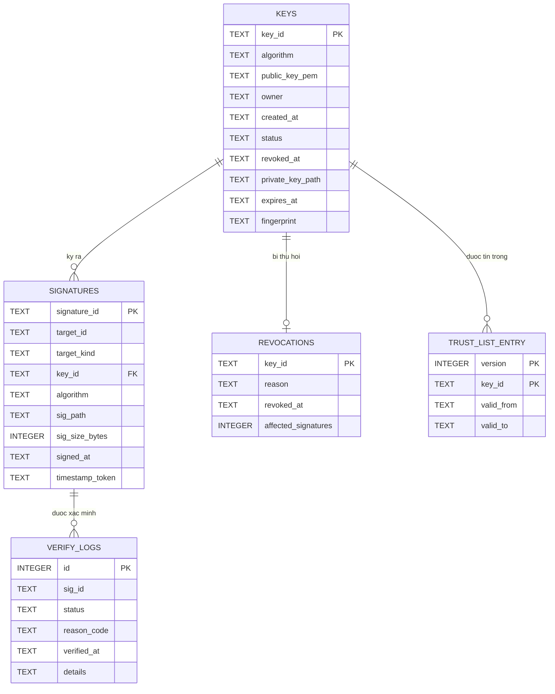

# Mô hình dữ liệu — sơ đồ ERD

> Người viết: **Phiêu** | Tuần: **2**

Lược đồ thật nằm ở `data/schema.sql`. Tài liệu này giải thích vì sao các
bảng được chia như vậy.

## 1. Sơ đồ quan hệ thực thể

## 2. Quyết định thiết kế và lý do

**Khóa riêng chỉ lưu đường dẫn, không lưu nội dung.** Cột
`private_key_path` giữ vị trí tệp, nội dung khóa riêng không bao giờ vào cơ
sở dữ liệu. Nếu lưu nội dung thì mọi bản sao lưu cơ sở dữ liệu trở thành
một bản sao của khóa riêng, và chỉ cần một bản sao lọt ra là hỏng tất cả
(NFR-04, NFR-06).

**Chữ ký tách thành bảng riêng, không nhét vào bảng `keys`.** Một khóa ký
được nhiều artifact, nên quan hệ là một–nhiều. Quan trọng hơn: khi một khóa
bị lộ, câu hỏi đầu tiên là "đã ký những gì bằng khóa này" — có bảng riêng
kèm chỉ mục trên `key_id` thì trả lời bằng một truy vấn, đó chính là lệnh
`affected` và yêu cầu FR-18.

**`target_kind` phân biệt artifact với manifest.** Hai thứ xác minh theo
hai cách khác nhau: artifact so trực tiếp nội dung, manifest còn phải đối
chiếu từng tệp trên đĩa. Lưu kiểu đối tượng ngay trong bản ghi giúp hàm
`verify` tự chọn đúng đường mà không phải đoán theo tên tệp.

**Bảng `revocations` tách khỏi cột `status` trong `keys`.** Cột `status`
chỉ trả lời "khóa này còn dùng được không". Bảng `revocations` trả lời câu
khó hơn: **thu hồi từ thời điểm nào**. Chữ ký tạo trước mốc đó có thể vẫn
đáng tin, chữ ký tạo sau thì không. Một cột trạng thái không chứa nổi thông
tin thời điểm nên bắt buộc phải có bảng riêng.

**`trust_list_entry` có khóa chính ghép `(version, key_id)`.** Trust list
không bao giờ sửa tại chỗ. Mỗi lần luân chuyển hay thu hồi là một phiên bản
mới, phiên bản cũ giữ nguyên để truy vết. Nhờ khóa ghép, một khóa xuất hiện
ở nhiều phiên bản với khoảng hiệu lực khác nhau — đó là cách giai đoạn
chồng lấn được ghi lại.

**`verify_logs` chỉ ghi thêm, dùng khóa tự tăng.** Không có cột nào để sửa
trạng thái một bản ghi cũ, và tầng lưu trữ không cung cấp hàm `UPDATE` hay
`DELETE` cho bảng này. Nhật ký bị sửa được thì nó không còn là bằng chứng,
liên hệ chữ R (Repudiation) trong mô hình đe dọa `docs/05`.

**Thời gian lưu dạng chuỗi ISO 8601.** SQLite không có kiểu ngày giờ riêng.
Chuỗi ISO sắp xếp theo thứ tự từ điển trùng với thứ tự thời gian, nên
`ORDER BY signed_at` cho kết quả đúng mà không cần hàm chuyển đổi.

## 3. Ràng buộc toàn vẹn

| Ràng buộc | Ở đâu | Chặn chuyện gì |
| --- | --- | --- |
| `PRAGMA foreign_keys = ON` | đầu `schema.sql` | Mặc định SQLite **tắt** khóa ngoại; không bật thì mọi `REFERENCES` bên dưới chỉ là chú thích |
| `signatures.key_id → keys.key_id` | khóa ngoại | Chữ ký trỏ tới khóa không tồn tại |
| `revocations.key_id → keys.key_id` | khóa ngoại | Thu hồi một khóa chưa từng đăng ký |
| `revocations.key_id` là khóa chính | ràng buộc duy nhất | Một khóa có hai mốc thu hồi mâu thuẫn nhau |
| `PRIMARY KEY (version, key_id)` | `trust_list_entry` | Một khóa có hai khoảng hiệu lực trong cùng một phiên bản |
| `idx_signatures_key` | chỉ mục | Không phải ràng buộc, nhưng là thứ làm lệnh `affected` chạy nhanh khi số chữ ký lớn |
| `NOT NULL` trên `signed_at`, `revoked_at` | cột | Bản ghi thiếu mốc thời gian, mà thiếu nó thì không phân loại được chữ ký trước và sau sự cố |

**Điều lược đồ KHÔNG ràng buộc được.** Cơ sở dữ liệu không kiểm được rằng
tệp ở `sig_path` thật sự tồn tại trên đĩa, cũng không kiểm được rằng mã băm
trong manifest khớp với tệp thật. Hai việc đó thuộc tầng nghiệp vụ và được
kiểm bằng bộ ca kiểm thử âm trong `tests/test_tamper.py`.
