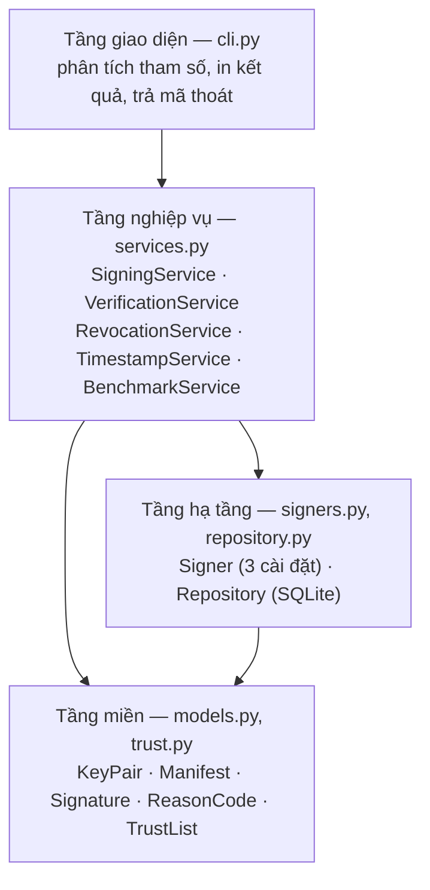
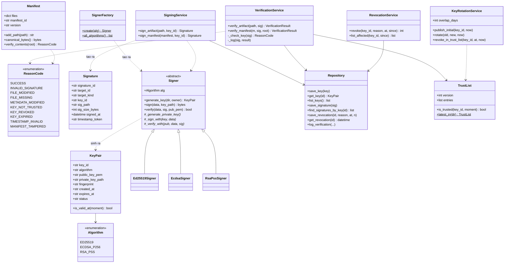
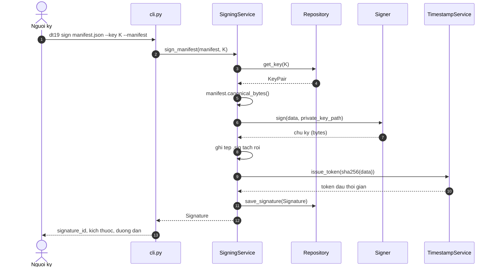
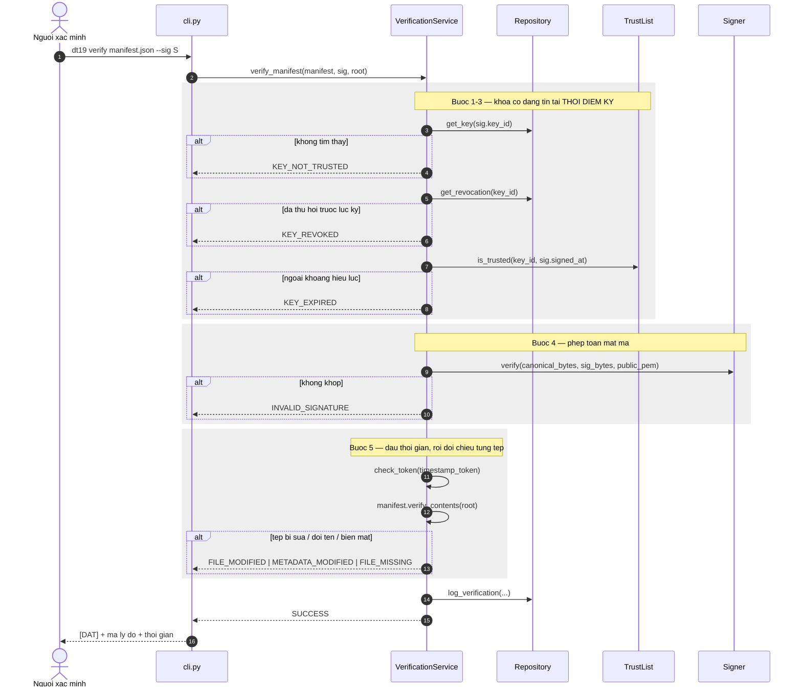

# Sơ đồ lớp và kiến trúc

> Người viết: **Phiêu và Long** | Tuần: **2**

## 1. Phân tầng

Bốn tầng, phụ thuộc chỉ đi một chiều từ trên xuống. Tầng dưới không biết gì
về tầng trên.

Lý do tách: tầng **nghiệp vụ** phải kiểm thử được mà không cần đụng tới đĩa
hay cơ sở dữ liệu thật. Vì `SigningService` chỉ phụ thuộc vào giao diện
`Signer` chứ không phụ thuộc vào `Ed25519Signer` cụ thể, và chỉ phụ thuộc
vào `Repository` chứ không phụ thuộc vào tệp `.db` nào, nên bộ kiểm thử
thay được bằng cơ sở dữ liệu trong bộ nhớ và chạy xong không để lại rác.

Bằng chứng tầng được tách đúng: 54 ca kiểm thử chạy trong 1,6 giây và không
sinh ra tệp nào ngoài thư mục tạm của pytest.

## 2. Sơ đồ lớp

## 3. Vì sao thiết kế như vậy

**`Signer` là lớp trừu tượng, ba thuật toán là ba lớp con.** Ba thuật toán
khác nhau hoàn toàn về toán học nhưng cùng làm ba việc: sinh khóa, ký, xác
minh. Phần khác nhau nằm ở bốn phương thức được bảo vệ; phần giống nhau
(ghi tệp khóa, đặt quyền 600, tính dấu vân tay, bắt ngoại lệ khi chữ ký
sai) viết một lần ở lớp cha.

Phép thử cho thiết kế này: thêm thuật toán thứ tư phải sửa những gì? Trả
lời: thêm một lớp con, thêm một dòng trong `SignerFactory.create`, thêm một
phần tử vào enum `Algorithm`. **Không đụng vào tầng nghiệp vụ.** Thực tế
tuần 4 thêm ECDSA và RSA-PSS vào sau Ed25519 mà `services.py` không phải
sửa dòng nào.

**`SignerFactory` là chỗ duy nhất biết tên ba lớp con.** Mọi nơi khác chỉ
cầm một đối tượng `Signer`. Nếu để `services.py` tự kiểm tra `if alg ==
"ed25519"` thì cái `if` đó sẽ nhân bản ra khắp nơi và thuật toán thứ tư
phải tìm sửa từng chỗ.

**`Repository` là giao diện, không phải SQLite.** Nhờ vậy bộ kiểm thử dùng
`Repository(db_path=":memory:")` và chạy xong không để lại tệp. Tầng nghiệp
vụ không hề biết dữ liệu nằm ở đâu.

**`TimestampService` tách riêng để bơm được thời gian giả.** Muốn kiểm tra
"khóa đã hết hạn tại thời điểm ký" mà phải chờ khóa hết hạn thật thì không
kiểm thử được. Tham số `fixed_now` làm đồng hồ đứng yên, nhờ đó ca kiểm thử
TC-10 mô phỏng được thời điểm cách hiện tại 20 ngày.

**`VerificationResult` trả về mã lý do chứ không trả `bool`.** Một hàm trả
`True`/`False` không ghi nổi nhật ký có ý nghĩa và không giúp người dùng
biết phải sửa gì. Đây là điều kiện để đạt chỉ số CS-6.

## 4. Luồng ký và luồng xác minh

Luồng xác minh có bốn bước kiểm tra, **thứ tự quyết định mã lý do trả về**:

**Vì sao tra trust list trước khi kiểm chữ ký.** Nếu làm ngược lại, một
khóa lạ nhưng ký đúng sẽ qua được bước mật mã rồi mới bị chặn, và thông báo
lỗi không nói được rằng vấn đề nằm ở **sự tin cậy** chứ không ở phép toán.

**Vì sao kiểm chữ ký trước dấu thời gian.** Dấu thời gian gắn với mã băm
của dữ liệu, nên mọi sửa đổi nội dung đều làm nó sai theo. Kiểm dấu thời
gian trước thì một tệp bị sửa sẽ báo `TIMESTAMP_INVALID` — đúng về mặt kỹ
thuật nhưng chỉ sai chỗ, và người dùng sẽ đi sửa nhầm thứ.
