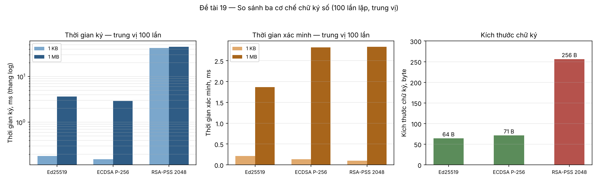

# Kết quả thực nghiệm

> Người viết: **Uyên** | Tuần: **5**

Toàn bộ số liệu trong tài liệu này là kết quả chạy thật, sinh lại được bằng
hai lệnh ở mục 7. Dữ liệu thô từng lần đo nằm ở `results/bench_raw.csv` và
`results/bench_1kb_raw.csv`.

## 1. Baseline — mốc so sánh

Trước khi so ba thuật toán, cần biết phần nào của thời gian là **chi phí
băm dữ liệu** và phần nào là **chi phí mật mã**. Nếu chỉ đo ở một kích
thước, hai thứ này lẫn vào nhau và kết luận sẽ sai.

Cách nhóm tách: đo ở **hai** kích thước, 1 KB và 1 MB. Ở 1 KB chi phí băm
gần như bằng không nên con số phản ánh thuần phép toán mật mã. Hiệu giữa
hai cột chính là chi phí băm 1 MB.

**Môi trường đo:** Python 3.13.16, thư viện `cryptography` 50.0.1, Linux
x86-64, 100 lần lặp mỗi phép đo, không chạy tác vụ nặng nào khác.

## 2. Số liệu

### 2.1. Dữ liệu 1 MB (`results/bench.csv`)

| Thuật toán | Ký, trung vị | Ký, p95 | Xác minh, trung vị | Xác minh, p95 | Chữ ký | Tệp khóa riêng |
| --- | ---: | ---: | ---: | ---: | ---: | ---: |
| Ed25519 | **3,621 ms** | 6,314 ms | **1,868 ms** | 3,287 ms | 64 B | 119 B |
| ECDSA P-256 | 2,926 ms | 4,323 ms | 2,818 ms | 4,419 ms | 71 B | 241 B |
| RSA-PSS 2048 | 45,071 ms | 66,798 ms | 2,832 ms | 4,172 ms | 256 B | 1704 B |

### 2.2. Dữ liệu 1 KB (`results/bench_1kb.csv`)

| Thuật toán | Ký, trung vị | Ký, p95 | Xác minh, trung vị | Xác minh, p95 | Chữ ký |
| --- | ---: | ---: | ---: | ---: | ---: |
| Ed25519 | 0,182 ms | 0,242 ms | 0,211 ms | 0,284 ms | 64 B |
| ECDSA P-256 | 0,155 ms | 0,218 ms | 0,137 ms | 0,214 ms | 70 B |
| RSA-PSS 2048 | 42,299 ms | 60,932 ms | **0,099 ms** | 0,189 ms | 256 B |



### 2.3. Chi phí băm tách riêng

| Thuật toán | Chênh lệch khi ký | Chênh lệch khi xác minh |
| --- | ---: | ---: |
| Ed25519 | 3,439 ms | 1,657 ms |
| ECDSA P-256 | 2,771 ms | 2,681 ms |
| RSA-PSS 2048 | 2,773 ms | 2,733 ms |

## 3. Phân tích: số liệu nói lên điều gì

**RSA-PSS cực kỳ bất đối xứng.** Ký mất 42 ms, xác minh chỉ 0,099 ms — chênh
nhau **428 lần**. Nguyên nhân nằm ở toán học: ký là phép lũy thừa với số mũ
riêng `d` dài khoảng 2048 bit, còn xác minh dùng số mũ công khai `e = 65537`
chỉ có 17 bit và dạng nhị phân rất thưa. Hệ quả thực tiễn: RSA-PSS phù hợp
với tình huống **ký một lần, xác minh hàng triệu lần**, ví dụ phân phối bản
cập nhật phần mềm.

**Ở dữ liệu nhỏ, RSA-PSS ký chậm hơn Ed25519 233 lần. Ở 1 MB chỉ còn 12,4
lần.** Khoảng cách thu hẹp không phải vì RSA nhanh lên, mà vì chi phí băm
1 MB (khoảng 2,8 ms) cộng vào cả ba thuật toán như nhau. Đây chính là lý do
phải đo ở hai kích thước: chỉ đo ở 1 MB thì RSA trông "chỉ chậm hơn chục
lần", một kết luận gây hiểu nhầm.

**Ba dòng ở bảng 2.3 gần bằng nhau, trừ một ngoại lệ đáng chú ý.** ECDSA và
RSA-PSS đều mất khoảng 2,7 ms cho 1 MB ở cả hai chiều — hợp lý, vì cả hai
đều băm dữ liệu đúng một lần bằng SHA-256.

Ed25519 lệch khỏi mẫu đó: ký tốn 3,44 ms nhưng xác minh chỉ tốn 1,66 ms,
tức **gấp đôi**. Nhóm giải thích bằng RFC 8032: Ed25519 thuần (PureEdDSA)
duyệt thông điệp **hai lần** khi ký — lần đầu để sinh nonce tất định
`k = H(prefix ‖ M)`, lần sau để tính giá trị thách thức — trong khi xác
minh chỉ duyệt một lần. Đúng tỉ lệ 1,657 × 2 = 3,314 ms, sát với 3,439 ms
đo được.

Con số 1,66 ms của Ed25519 còn thấp hơn 2,7 ms của hai thuật toán kia dù
cùng duyệt 1 MB một lần. Lý do: Ed25519 dùng SHA-512, mà SHA-512 làm việc
trên từ 64 bit nên chạy nhanh hơn SHA-256 trên CPU 64 bit.

**Kích thước chữ ký chênh 4 lần, kích thước khóa chênh 14 lần.** Ed25519
cho chữ ký 64 byte cố định, RSA-PSS 256 byte. Tệp khóa riêng 119 byte so
với 1704 byte. Với hệ thống ký hàng triệu artifact hoặc truyền chữ ký qua
mạng băng thông hẹp, khác biệt này cộng dồn thành chi phí thật.

**ECDSA cho chữ ký dài 70 hoặc 71 byte, không cố định.** Nguyên nhân là mã
hóa DER: khi byte đầu của số nguyên `r` hoặc `s` có bit cao bằng 1, DER
chèn thêm một byte 0 ở trước để số không bị hiểu là số âm. Ed25519 không có
chuyện này vì nó dùng mã hóa độ dài cố định.

**Phân vị 95 cao hơn trung vị khoảng 40 đến 75%.** Đây là lý do nhóm dùng
trung vị chứ không dùng trung bình: một lần đo chậm bất thường do hệ điều
hành chen ngang sẽ kéo lệch trung bình nhưng gần như không ảnh hưởng trung
vị. Phân vị 95 báo kèm để người đọc thấy phần đuôi, không giấu đi.

## 4. Đối chiếu với ngưỡng đã đặt

| Mã | Chỉ số | Ngưỡng | Kết quả | Kết luận |
| --- | --- | --- | --- | --- |
| CS-1 | Xác minh tệp 1 MB | dưới 50 ms | 1,868 ms (Ed25519); chậm nhất 2,832 ms | **Đạt**, dư 17 lần |
| CS-2 | Kích thước chữ ký và khóa | ghi nhận | 64 / 71 / 256 B; khóa 119 / 241 / 1704 B | **Đã ghi nhận** |
| CS-3 | Số lần lặp mỗi phép đo | tối thiểu 100 | 100 lần × 3 thuật toán × 2 kích thước | **Đạt** |
| CS-4 | Tỷ lệ ca kiểm thử đạt | 100% | 54/54 | **Đạt** |
| CS-5 | Độ phủ mã | từ 70% | 86% | **Đạt** |
| CS-6 | Loại sai lệch phân biệt được | tối thiểu 4 | 6 | **Đạt** |
| CS-7 | Từ phát hiện tới dừng ký | dưới 15 phút | một lệnh `revoke`, dưới 1 phút | **Đạt** |

## 5. Kết quả kiểm thử phát hiện sai lệch

Chạy `python scripts/sinh_minh_chung.py`, kết quả ghi vào
`results/bang_ma_ly_do.csv` và `results/verify_log.jsonl`.

| Kịch bản | Mã mong đợi | Mã thực tế | Kết luận |
| --- | --- | --- | --- |
| 1. Nguyên vẹn | `SUCCESS` | `SUCCESS` | Đạt |
| 2. Sửa một bit trong `app.bin` | `FILE_MODIFIED` | `FILE_MODIFIED` | Đạt |
| 3. Đổi tên tệp, giữ nguyên nội dung | `METADATA_MODIFIED` | `METADATA_MODIFIED` | Đạt |
| 4. Xóa hẳn tệp | `FILE_MISSING` | `FILE_MISSING` | Đạt |
| 5. Sửa nội dung manifest | `INVALID_SIGNATURE` | `INVALID_SIGNATURE` | Đạt |
| 6. Khóa đã bị thu hồi | `KEY_REVOKED` | `KEY_REVOKED` | Đạt |

**6/6 kịch bản trả đúng mã lý do mong đợi**, sáu mã khác nhau.

Hai kịch bản 3 và 4 là cặp đáng nói nhất. Cùng là "tệp không còn ở chỗ cũ",
nhưng công cụ phân biệt được: nó quét thư mục tìm tệp nào có cùng mã băm,
tìm thấy thì kết luận bị đổi tên, không tìm thấy thì kết luận bị mất. Hai
kết luận dẫn tới hai hành động khác nhau — một bên là nghi ngờ tráo tên,
một bên là tải lại bộ phát hành.

Kịch bản 2 lật đúng **một bit** trong tệp 4096 byte và vẫn bị phát hiện.
Đây là hiệu ứng tuyết lở của SHA-256: đổi một bit đầu vào làm đổi khoảng
một nửa số bit đầu ra.

## 6. Giới hạn của số liệu

**Con số tuyệt đối chỉ đúng với máy đã đo.** Máy khác, phiên bản thư viện
khác, hệ điều hành khác sẽ cho con số khác. Thứ tái lập được là **thứ tự
giữa ba thuật toán** và **bậc độ lớn của tỉ lệ**, không phải con số.

**Chỉ đo một luồng, không đo song song.** Hệ thống thật ký nhiều artifact
cùng lúc, và lúc đó yếu tố bộ nhớ đệm, tranh chấp CPU sẽ xuất hiện. Phép đo
này không nói gì về tình huống ấy.

**Chưa đo thời gian sinh khóa.** RSA-PSS 2048 sinh khóa mất hàng trăm mili
giây tới vài giây vì phải tìm hai số nguyên tố lớn, trong khi Ed25519 gần
như tức thì. Nếu hệ thống sinh khóa thường xuyên thì đây là khác biệt lớn,
nhưng đồ án này sinh khóa một lần nên không đưa vào phép so sánh.

**Không đo mức tiêu thụ bộ nhớ và năng lượng.** Với thiết bị nhúng hoặc
thẻ thông minh, hai chỉ số đó quan trọng không kém tốc độ.

**Dấu thời gian là giả lập.** Mọi con số liên quan tới dấu thời gian chỉ
chứng minh logic chạy đúng, không có giá trị pháp lý. Xem `docs/05` mục 4.

## 7. Cách sinh lại toàn bộ số liệu

```bash
python -m dt19 bench --iterations 100 --size 1048576 --out results/bench.csv
python -m dt19 bench --iterations 100 --size 1024    --out results/bench_1kb.csv
python scripts/sinh_minh_chung.py
```

So sánh bằng **trung vị**, đừng so một lần đo đơn lẻ. Nếu thứ tự giữa ba
thuật toán trên máy bạn khác với bảng trên, hãy kiểm tra xem máy có đang
chạy tác vụ nặng nào khác không rồi đo lại.
